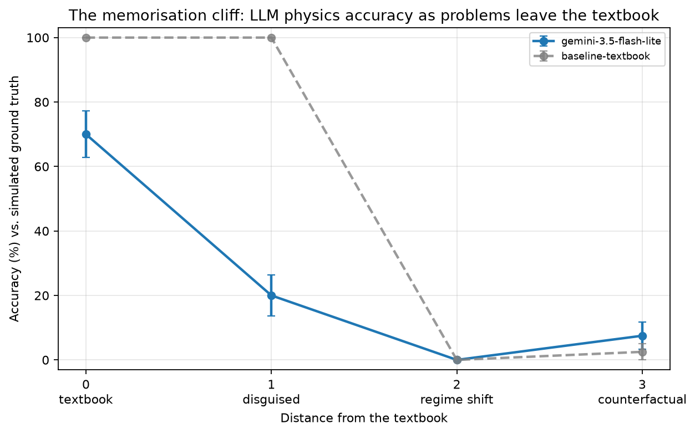

# PhysBreak: where do LLMs break physics?

**How far can a physics problem move away from the textbook before an LLM's answers fall apart?**

PhysBreak is a simulation-verified benchmark that measures this directly. Every problem is
generated with random parameters and checked against a **numerical simulation**, not a
hand-written answer key, so the problems cannot be in any model's training data and the
benchmark can be regenerated at any size.

Built for the OSI (Open Scientific Intelligence) Hackathon 2026.

## The idea: a "distance from the textbook" axis

Each problem family is pushed through the same levels:

| Level | Name | What changes | What it tests |
|---|---|---|---|
| 0 | Textbook | Standard problem, standard wording | Baseline knowledge |
| 1 | Disguised | Same physics, invented names and units | Recognition vs. reasoning |
| 2 | Regime shift | Parameters where the textbook approximation silently fails | Knowing when a formula stops applying |
| 3 | Counterfactual | Modified physical laws no textbook covers | Reasoning from first principles |
| 4 | Chaos | Questions that may be unanswerable | Honesty about predictability |

The headline result is the **memorisation cliff**: accuracy as a function of distance from the
textbook.

## Problem families (168 problems, 8 per family per level)

| Family | L2 regime shift | L3 counterfactual |
|---|---|---|
| Pendulum | 120 to 170 degree amplitude (small-angle formula fails) | restoring force proportional to theta^3 |
| Projectile | strong quadratic air drag | drag proportional to v^3 |
| Orbit | highly eccentric orbit | gravity proportional to 1/r^1.5, 1/r^2.5, 1/r^3 |
| Charged particle | relativistic speeds (0.8c to 0.99c) | magnetic force scaled by (v/u)^2 |
| Quantum well | finite well depth | V(x) proportional to abs(x)^3 |

Level 4 (pendulum only for now): a double pendulum with initial angles known to +/-0.1 degrees.
The ground truth comes from an ensemble of perturbed simulations: if the outcomes spread by more
than 10 degrees, the correct answer is `UNPREDICTABLE`. Half the cases are low-energy and fully
predictable, so a model cannot score by always refusing.

## How the ground truth is validated

All answers come from numerical integration (SciPy `solve_ivp`, tolerances around 1e-10) or a
finite-difference Schrodinger solver. `tests/test_ground_truth.py` checks these against exact
results wherever they exist: the elliptic-integral pendulum period, Kepler's third law for
eccentric orbits, the relativistic cyclotron radius, the exact finite-well solution, the harmonic
oscillator, and the exact lambda^(2/5) scaling law for the cubic potential.

## Failure taxonomy

Every wrong answer is classified automatically:

- **textbook_trap**: the model gave what the textbook formula predicts, in a regime where that
  formula is wrong. This is the signature of pattern-matching instead of reasoning.
- **factor_error**: off by a common factor (2, pi, 2pi, 4, sqrt 2).
- **unit_or_magnitude**: off by a power of ten.
- **false_certainty**: gave a confident number for a truly chaotic system.
- **false_abstain**: said `UNPREDICTABLE` when the answer was predictable.
- **other_wrong**, **no_answer**, **parse_error**.

Two offline baselines anchor the results: `baseline-textbook` always answers with the textbook
formula (a pure "memoriser"), and `baseline-oracle` always answers correctly (checks the grader).

## Results

_Figures are generated into `figures/` by the analysis step._



## Run it yourself

```bash
pip install -r requirements.txt
export GEMINI_API_KEY="your-key"          # Windows PowerShell: $env:GEMINI_API_KEY="your-key"

python list_models.py                      # see which Gemini models your key can use
python -m physbreak.generate --n 8         # (optional) regenerate data/problems.json
python -m physbreak.run --models <model-name> --sleep 4
python -m physbreak.analysis               # figures/ + summary tables
marimo edit notebook.py                    # interactive results explorer
python tests/test_ground_truth.py          # validate the simulators
```

Runs are resumable: re-running skips problems already answered, so free-tier rate limits never
lose progress.

## Repository layout

```
physbreak/families/   one module per physics family (generator + simulator)
physbreak/generate.py builds data/problems.json
physbreak/models.py   Gemini backend + offline baselines
physbreak/run.py      resumable runner -> results/<model>.jsonl
physbreak/grade.py    scoring + failure taxonomy
physbreak/analysis.py figures and tables
notebook.py           marimo notebook for exploring results
tests/                ground-truth validation against exact solutions
```

## Next steps

More families (RLC circuits, real gases, Ising model near criticality, tunnelling, relativistic
kinematics); chaos levels for orbits (three-body); more models; and a "physicist's verifier" that
checks LLM answers using dimensional analysis, limiting cases and conservation laws.

## Acknowledgements

This project was developed with the help of an AI assistant (Claude), which was used for
design discussion and for writing much of the code.
